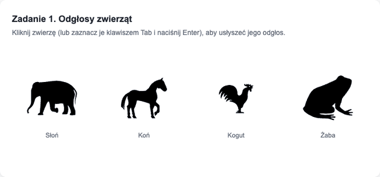
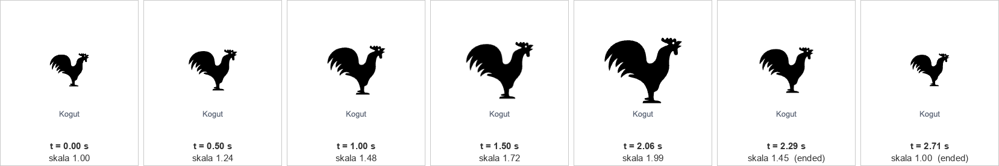
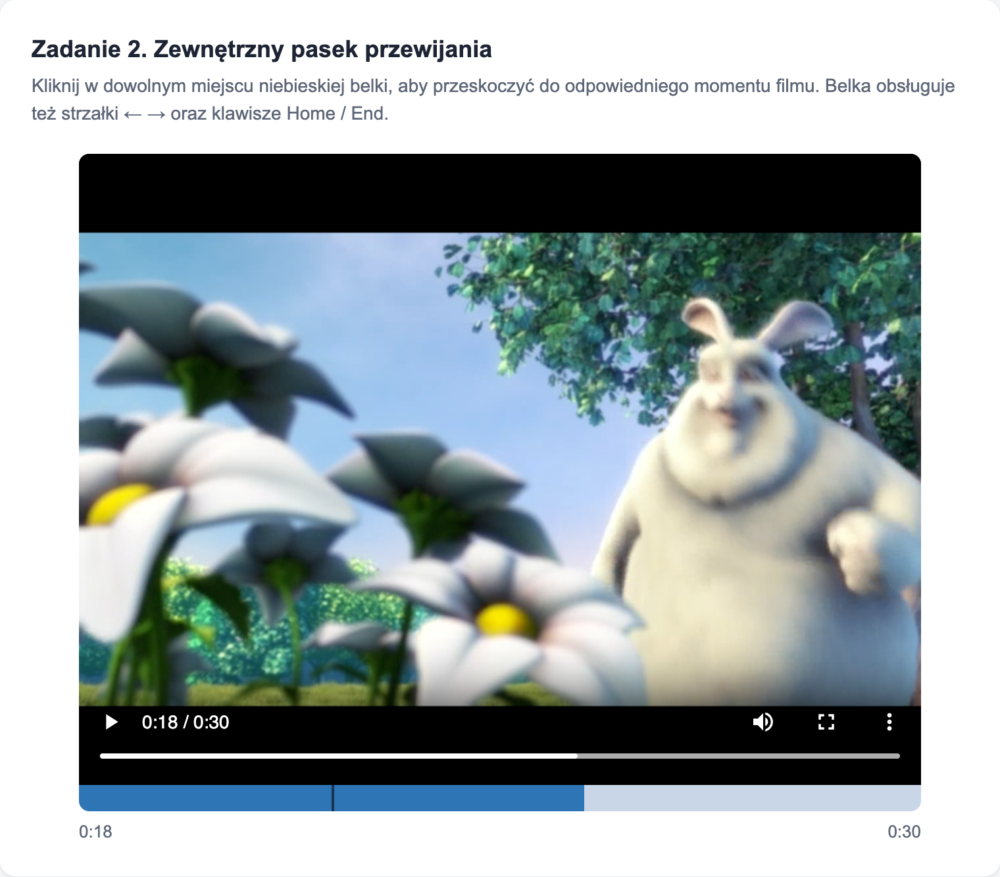
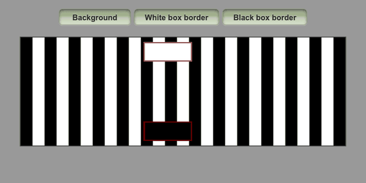
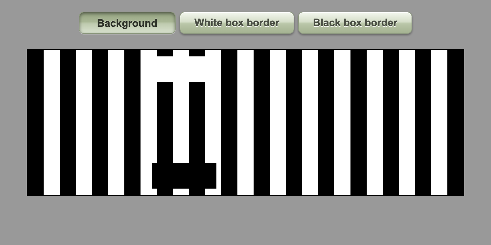
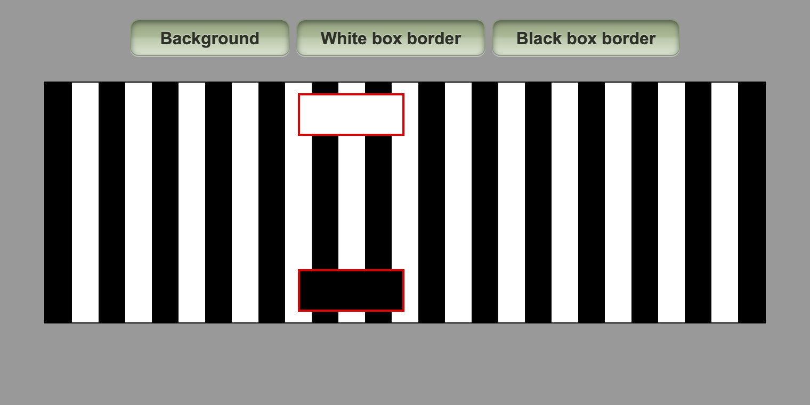
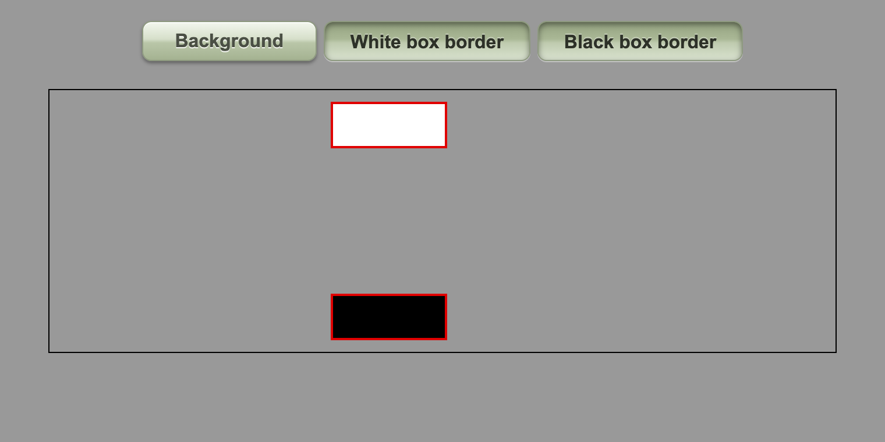

# Laboratorium 5 – Elementy multimedialne i złudzenia optyczne (HTML + CSS)

📄 Raport: [PDF](PUX_lab05_raport.pdf) · [DOCX](PUX_lab05_raport.docx)
📁 Kod: [`lab05/multimedia.htm`](lab05/multimedia.htm) (zadania 1–2) · [`lab05/blocks.html`](lab05/blocks.html) (zadanie 3)

Strony działają lokalnie: wystarczy otworzyć plik w przeglądarce. Nie potrzeba serwera ani Internetu, bo jQuery z `http://code.jquery.com` zastąpiono czystym JavaScriptem.

---

## Zadanie 1 – dźwięki zwierząt

- 4 elementy `<audio>` **bez `controls`**, czyli niewidoczne na stronie (koń ma źródła `.ogg` i `.mp3`),
- obrazy mają `width: 100px; height: auto`,
- kliknięcie (lub Enter/Spacja) odtwarza plik o tej samej nazwie (`"sound" + img.id`),
- obraz rośnie do `scale(2)`, a **czas tranzycji = `audio.duration`**,
- zdarzenie **`ended`** przywraca skalę 1 w **0,5 s**.

Pomiar z `getComputedStyle` dla koguta (rooster.mp3 = 2,06 s): skala rośnie liniowo 1 → 2, a po `ended` wraca w ok. 0,5 s.

## Zadanie 2 – zewnętrzny pasek przewijania

Belka pod filmem ma szerokość filmu. Kliknięcie ustawia `video.currentTime = (x / szerokość) * video.duration`.

Dodatkowo (nieobowiązkowe) są: wypełnienie pokazujące bieżącą pozycję, licznik czasu, znacznik pod kursorem oraz obsługa klawiatury (`role="slider"`, ← → co 5 s, Home/End).

Test: kliknięcie w 60% belki daje `currentTime` = 18,598 s, czyli dokładnie 0,6 × 30,997 s.

## Zadanie 3 – przyciski złudzenia „footsteps”

Trzy przyciski przełączają klasy na `#track`: `proof` (tło), `border-light` (ramka białego bloku), `border-dark` (ramka czarnego bloku). Stan zapisuje `aria-pressed`, a CSS na jego podstawie rysuje przycisk:

| Stan | Wygląd | CSS |
|---|---|---|
| wyłączony | **wypukły** | gradient jasny → ciemny, zewnętrzny cień, `text-shadow` pod literami |
| włączony | **wklęsły** | gradient odwrócony, `box-shadow: inset`, tekst przesunięty w dół |

| Tło włączone, bez ramek | Obie ramki | Bez tła |
|---|---|---|
|  |  |  |

Bloki poruszają się ze stałą prędkością. Złudzenie „kroków” bierze się ze zmiany kontrastu krawędzi bloku z pasami tła (Anstis, 2001). Czerwona ramka ma stały kontrast z tłem, więc złudzenie znika.

## Weryfikacja

Wszystkie wymagania sprawdzono automatycznie w Chrome 128 (Playwright). Pełna tabela wyników jest w raporcie, w punkcie 5.
